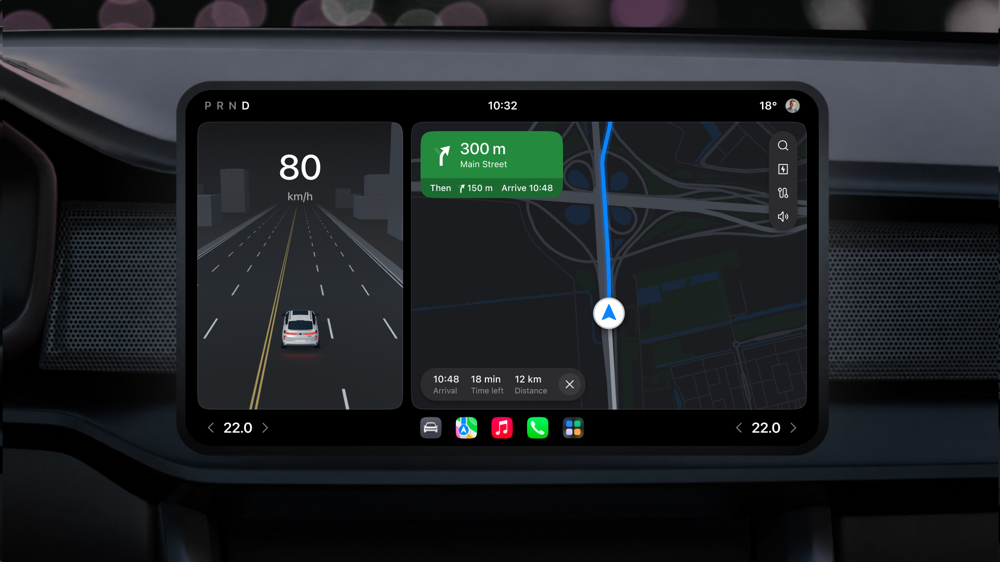
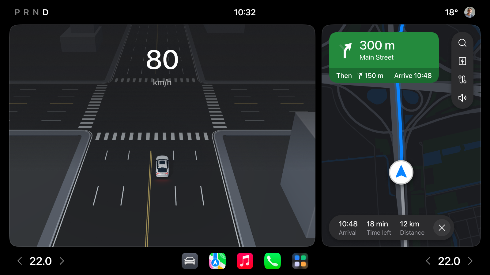
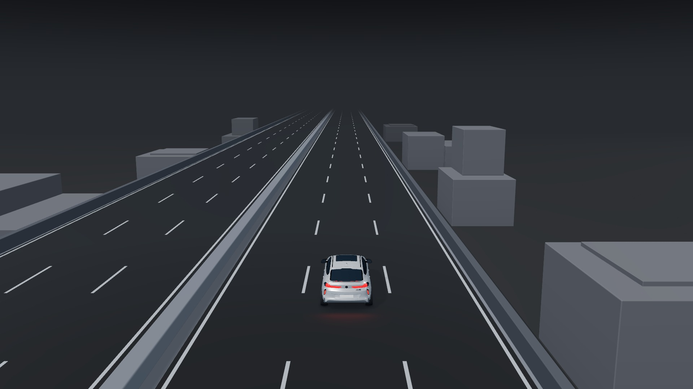
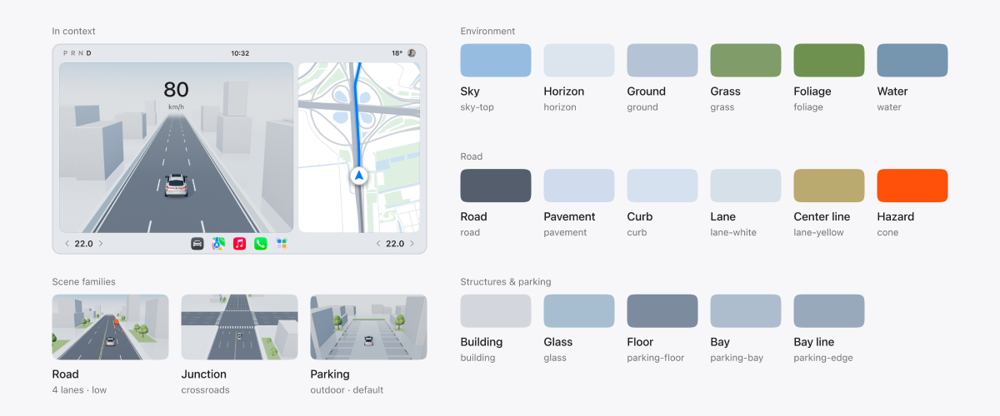
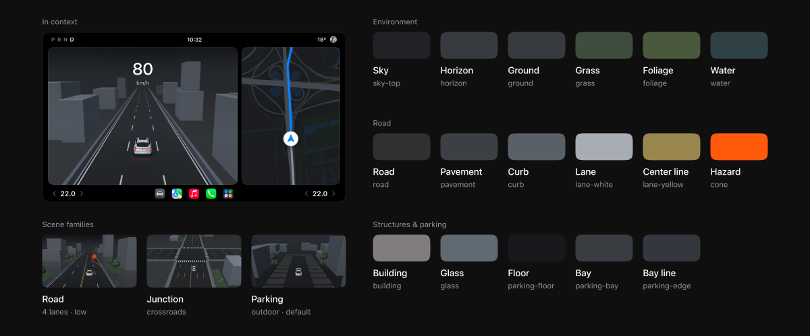

# DriveScene Studio

### 3D Backgrounds for Cockpit UI Design

An open-source base for designing intelligent-driving SR visualizations and automotive cockpit interfaces, with configurable 3D driving and parking scene backgrounds. Choose a scenario, adjust its appearance and camera, and export a 1920 × 1080 PNG to use in your layout.

[Open the live tool](https://paxton0209.github.io/DriveScene-Studio/) · Created by Peixin

## Why this project exists

A driver's view is shaped by the vehicle around them. A-, B- and C-pillars, and D-pillars where present, can obscure parts of the surroundings when turning, changing lanes or manoeuvring. Exterior cameras and other sensors observe the environment from different positions. When their inputs are combined, a vehicle can build an environmental model that supplements the driver's direct view. SR visualizations bring selected parts of that model into the cockpit interface, showing the road layout and detected objects around the vehicle. What they can show depends on sensor coverage and detection quality; a visualization cannot guarantee a complete view of every hazard.

For an interface designer, building an SR concept often means working with a 3D designer on road geometry, vehicle placement, camera framing, materials and lighting. Each new scenario or layout can require another round of modelling and colour adjustment. At the same time, the SR scene shares attention with speed, navigation, alerts and controls. Detailed scenery, strong colours and dense geometry can make those UI elements harder to distinguish.

This project provides a reusable starting point for that work: simplified environments with restrained colours and adjustable scene elements. Designers can compare common driving and parking contexts, choose the amount of environmental detail they need, and bring a consistent background into a cockpit layout without rebuilding the scene for every iteration. It supports early exploration of composition and visual hierarchy; it does not evaluate driving safety or connect to a vehicle's perception system.

## From background to cockpit interface

This example comes from the project's Figma design workspace. The SR scene sits alongside navigation, with speed and other UI information layered over a quiet environment. Its geometry remains readable while the interface retains its hierarchy. The complete cockpit screen illustrates how an exported background can be used in interface design; the website exports the scene itself, without speed labels, navigation or app controls.

Start with the closest driving or parking scenario, adjust the camera and visual density, then download the PNG and place it in Figma or another design tool. Add your interface elements and check how they read over the scene. When the layout changes, return to the tool to compare another viewpoint or reduce environmental detail.

## What you can configure

| Control | Available choices |
| --- | --- |
| Driving scenario | Road, elevated road, junction and ramp |
| Parking scenario | Indoor and outdoor parking |
| Appearance | Light and dark modes for day/night interface exploration |
| Road layout | Straight roads; 2, 4 or 6 lanes |
| Junction and ramp | Crossroads or T-junction; exit or merge |
| Camera | Low/high road and ramp views, and scenario-specific parking viewpoints, including bird's-eye views |
| Vehicle | BMW X6, Tesla Model 3, BMW iX or Volvo XC90; the selected vehicle remains visible across scenes |
| Scene elements | Buildings, trees, waterfront and roadworks, where supported by the selected scenario |
| Export | 1920 × 1080 PNG, camera JSON, 16-bit depth PNG and a perspective kit ZIP |

Camera changes animate through the 3D scene; other options use short transitions. Reduced-motion preferences are respected. Elevated roads and ramp mainlines have separated opposing carriageways; the elevated deck sits 8.5 m above ground with ground-level side streets and bridge supports.

Options follow the selected scenario. Light and dark modes provide visual themes for design exploration, rather than a physical simulation of changing daylight. On mobile, the navigation expands within the page and stays open while comparing scenes.

Open Vehicle to choose a model without changing the scene or camera. The selector supports arrow keys, Home and End, reuses recently prepared models within a bounded resource budget, and preserves the current vehicle if a new model cannot load. Indoor and outdoor parking share the same bay dimensions and spacing. Model attribution follows the selected vehicle in perspective-kit exports; additional sources and preparation notices are in [vehicle-library/CREDITS.md](vehicle-library/CREDITS.md).

## Camera, depth and Figma alignment

Click the download icon to open the centered format dialog. PNG image is selected by default; the other choices are **Perspective kit**, **Camera settings** and **Depth map**. The kit contains the matching scene PNG, camera JSON, depth PNG, a transparent perspective SVG and usage notes. Active scene and camera animations settle to the selected endpoint before capture; all files in a kit describe that same final frame.

Place `scene.png` and `perspective.svg` at (0, 0) in a 1920 × 1080 Figma frame, without cropping. The SVG grid uses 1 m columns and 5 m rows on a horizontal plane at the ego vehicle's road height. A 2 m × 3.5 m reference arrow starts 18 m ahead. Use it to align navigation artwork, then hide the reference layer. The guide does not follow branch/ramp geometry or account for occlusion. Figma does not import the JSON as a 3D camera or automatically perspective-warp artwork.

The camera JSON includes the full projection and view matrices, orientation, FOV, clipping planes and view offset. Matrices are column-major; world units are meters with Y up, and the camera faces local -Z. The image origin is top-left. Preserve the projection matrix, including the view offset, when recreating the camera.

Depth PNG is 16-bit linear grayscale camera-space Z distance: `meters = uint16 / 65535 * 200`. Near geometry is dark; sky and distances at or beyond 200 m are white. Depth edges are not antialiased, and decorative transparency, glow and contact shadows are excluded. Water is represented by its surface. These depths support compositing and geometry workflows; use the SVG for manual Figma alignment. The package includes environment and vehicle attribution.

## Scene preview

## SR colour specification

The scenes use a restrained, cool palette so that speed, navigation and alerts stay on top. Roadwork cones are the only saturated colour, reserved for hazards. The [SR colour specification](docs/SR-COLOR.md) lists every scene colour in light and dark themes, the lighting values, and how the palette is meant to sit behind an interface.

 

## Run

The checked-in `app.bundle.js` is ready to use. Serve this folder with any static web server. For example, run `python3 -m http.server 8000` and open http://localhost:8000. Do not open index.html using a file URL.

## Develop

Install Node.js, run `npm install`, then `npm run build`. Source modules are included beside the prebuilt bundle. The delivery vehicle bakes fixed geometry and material edits, removes cabin geometry hidden by opaque windows, and uses 16-bit position / 12-bit normal quantization, Meshopt and gzip. See [the preparation recipe](scripts/README.md) to regenerate it from the included source. A scene-matched WebP provides the first complete frame while the full vehicle and shaders initialize. The interactive preview and PNG export use the same model. Refresh preserves the selected environment and restores the previous frame while initialization finishes. Fixed studio lighting is pre-baked, and framing projects a cached convex hull to reduce startup work. Previews adapt their resolution to the display size, reuse recently visited scene geometry, and compile new scene shaders asynchronously; PNG downloads always render at 1920 × 1080.

## Hosting

Deploy this folder to a static HTTPS host. All runtime assets are relative to this folder, so it can run in a GitHub Pages project subdirectory. No API, backend or secret is needed.

## Contents and attribution

This repository contains the DriveScene Studio website, its runtime assets and rendered cockpit examples used in this README. Editable Figma files, internal review pages, feedback and comparison screenshots are excluded. The cockpit examples are illustrative UI compositions; their third-party app icons, vehicle-interior photography and other third-party elements are not relicensed as original project assets. See CREDITS.md and THREE-LICENSE.txt for runtime attribution. The vehicle declares CC BY 4.0 in embedded metadata; keep its attribution. The Visual key reference section and its reference images are excluded from this website package.

## License

Original application code is licensed under [MIT](LICENSE), copyright (c) 2026 Peixin. Original environments and rendered backgrounds are [CC BY 4.0](ASSET-LICENSE.md). The bundled vehicle and third-party code retain their own notices in [CREDITS.md](CREDITS.md) and [THREE-LICENSE.txt](THREE-LICENSE.txt). The Meshopt decoder license is in [MESHOPT-LICENSE.txt](MESHOPT-LICENSE.txt). Include both environment and vehicle attribution when sharing an exported image that contains the vehicle.

## Background reading

[Tesla's driving visualization documentation](https://www.tesla.com/ownersmanual/model3/en_us/GUID-2CB60804-9CEA-4F4B-8B04-09B991368DC5.html) illustrates how detected roads and objects can be represented on a cockpit display. [Volvo's camera limitations documentation](https://www.volvocars.com/en-sa/support/car/v90/16w46/article/dcc0393b8976b065c0a80151160585ff/) describes gaps in camera coverage. These references provide context for SR interface exploration and do not indicate an affiliation with either manufacturer.

## Download additional vehicle models

The [vehicle library](vehicle-library/README.md) contains complete original BMW iX, Volvo XC90, Tesla Model 3 (2024), Tesla Model Y and Porsche Taycan assets, plus four prepared delivery variants. It includes attribution, checksums and a standard-library Python downloader for use on another computer. Run `python3 vehicle-library/download.py --output vehicle-models` after cloning.
