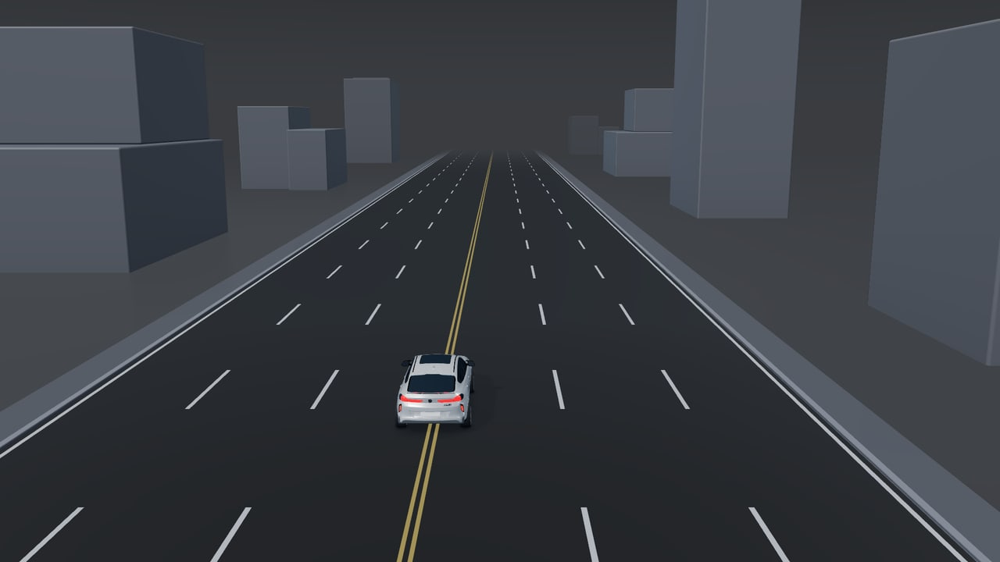

# SR Base

Interactive driving-scene backgrounds for cockpit interface design. Includes a vehicle model, 2/4/6 lanes, low/high cameras, junctions, ramps and indoor/outdoor parking. Available scene elements can be toggled independently. PNG export uses a 1920 × 1080 canvas.

[Open SR Base](https://paxton0209.github.io/sr-base/) · Created by Peixin. Mobile navigation expands in the page and stays open while comparing scenes.

## Run

The checked-in `app.bundle.js` is ready to use. Serve this folder with any static web server. For example, run `python3 -m http.server 8000` and open http://localhost:8000. Do not open index.html using a file URL.

## Develop

Install Node.js, run `npm install`, then `npm run build`. Source modules are included beside the prebuilt bundle. The vehicle uses lossless Meshopt compression and gzip. Navigation and the environment initialize before the vehicle finishes loading. Mobile previews use an adaptive canvas; PNG downloads always render at 1920 × 1080.

## Hosting

Deploy this folder to a static HTTPS host. All runtime assets are relative to this folder, so it can run in a GitHub Pages project subdirectory. No API, backend or secret is needed.

## Contents and attribution

This repository contains only the SR Base website and its runtime assets. Figma design files, internal review pages, feedback and comparison screenshots are excluded. See CREDITS.md and THREE-LICENSE.txt. The vehicle declares CC BY 4.0 in embedded metadata; keep its attribution. The Visual key reference section and its reference images are excluded from this website package.

## License

Original application code is licensed under [MIT](LICENSE), copyright (c) 2026 Peixin. Original environments and rendered backgrounds are [CC BY 4.0](ASSET-LICENSE.md). The bundled vehicle and third-party code retain their own notices in [CREDITS.md](CREDITS.md) and [THREE-LICENSE.txt](THREE-LICENSE.txt). The Meshopt decoder license is in [MESHOPT-LICENSE.txt](MESHOPT-LICENSE.txt). Include both environment and vehicle attribution when sharing an exported image that contains the vehicle.
