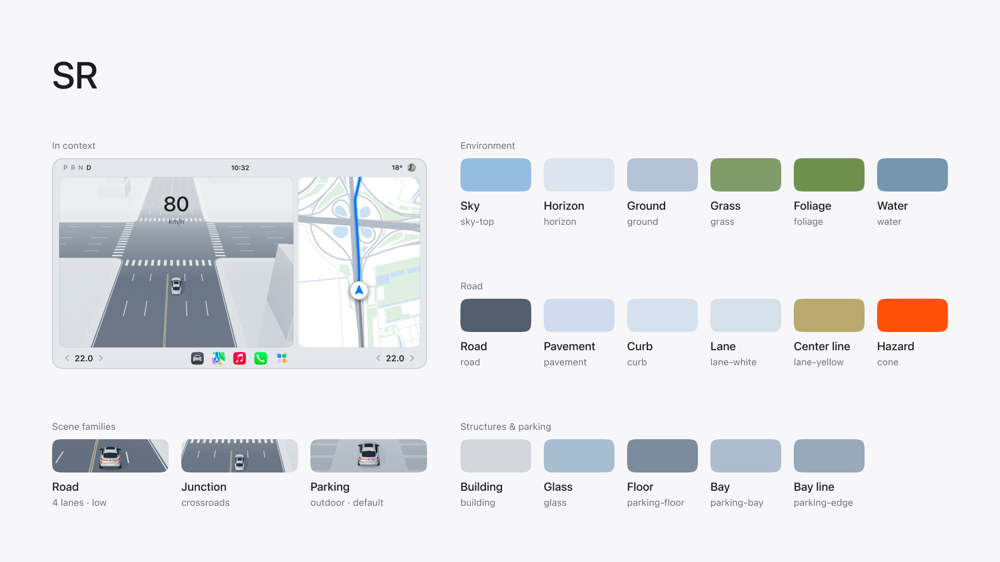
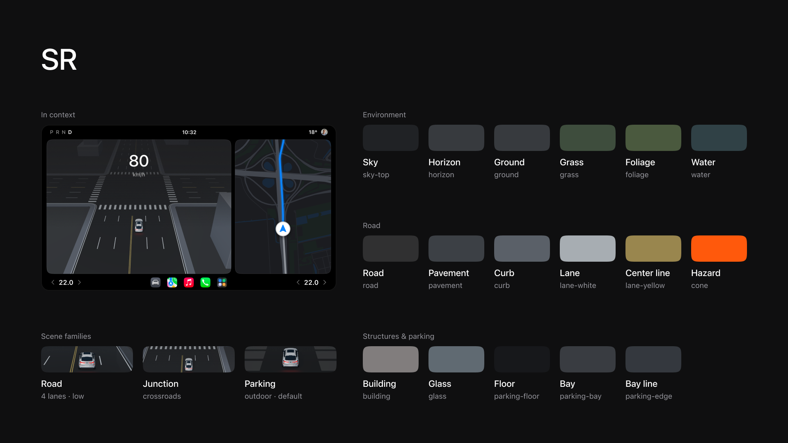

# SR colour specification

The colours DriveScene Studio uses for its 3D driving and parking scenes, in light and dark themes, and the reasoning behind them. Use this page when you match a cockpit interface to an exported background, extend the scenes, or rebuild the palette in your own design system.

Each board shows examples on the left (the scene behind a full cockpit screen, and the three scene families) and the colour tokens on the right, grouped by environment, road, and structures and parking.

## What the palette is for

An SR scene is never the main subject of a cockpit screen. It sits behind speed, navigation, alerts and controls, and it has to stay readable without competing with them. The palette follows from that:

1. **Quiet, cool and low in saturation.** Roads, ground, buildings and sky are blue-greys and neutral greys. Saturated colour is left for the interface: navigation blue, success green, warning and alert states.
2. **One saturated colour, reserved for hazards.** Roadwork cones (`cone`) are the only fully saturated colour in the scene. If you place UI over a background, keep orange and red for warnings too, so the scene and the interface use the same signal.
3. **Structure comes from luminance, not hue.** The road layout should be readable in greyscale. The two themes get there in different ways (see below).
4. **No pure black or pure white.** The darkest dark-theme surface is `#17181B` and the brightest lane line is `#D6E0E9`. White text and icons placed over the scene stay brighter than anything in it.

### Light theme

The road is the darkest large surface, so the drivable area reads first. Road against ground is about 3.7:1, and lane lines against the road are about 4.9:1. Buildings sit close to the ground tone (about 1.2:1), so they describe the city without drawing attention. The horizon fades into a pale blue haze (`horizon`), which leaves calm space at the top of the frame for speed and status.

### Dark theme

The road surface is close to the ground (about 1.2:1), so the layout is carried by the lane lines (about 5.8:1 against the road) and kerbs. The horizon and the ground use the same value (`#373A3E`), so there is no hard horizon edge behind interface elements. Buildings are a mid grey, lifted about 2.8:1 from the ground, so they keep their shape without glowing. Lane lines are light grey rather than white to avoid glare in a night-time interface.

Contrast figures are WCAG relative-luminance ratios between base colours. They describe the hierarchy of the scene; they are not accessibility claims for text.

## Tokens

Token names match the Figma variables (`sr/<token>` in the Color collection, Dark and Light modes) and are listed with the key used in `world.js`.

### Environment

| Token | Role | Light | Dark | Code |
| --- | --- | --- | --- | --- |
| `sky-top` | Top of the sky gradient | `#96BDE0` | `#202225` | sky uniform `top` |
| `horizon` | Sky at the horizon and fog colour | `#DCE5EE` | `#373A3E` | sky uniform `bottom`, `scene.fog` |
| `ground` | Open ground beside the road | `#B4C3D6` | `#373A3E` | `colors.ground` |
| `grass` | Verges and planted strips | `#809C68` | `#3E4D3D` | `colors.grass` |
| `foliage` | Tree canopies | `#6F914F` | `#4A593E` | `colors.leaf` |
| `water` | Coast and waterfront | `#7695AE` | `#304146` | `colors.water` |

### Road

| Token | Role | Light | Dark | Code |
| --- | --- | --- | --- | --- |
| `road` | Carriageway surface | `#545E6D` | `#303031` | `colors.road` |
| `pavement` | Pavements and islands | `#D1DBEE` | `#3C4045` | `colors.pavement` |
| `curb` | Kerbs and road edges | `#D6E1EF` | `#5A6068` | `colors.curb` |
| `lane-white` | Lane lines, crossings, stop lines | `#D6E0E9` | `#A7ADB2` | `colors.white` |
| `lane-yellow` | Centre lines | `#BBAA6F` | `#99864E` | `colors.yellow` |
| `cone` | Roadworks, hazard accent | `#FF5109` | `#FF590C` | `colors.cone` |

### Structures and parking

| Token | Role | Light | Dark | Code |
| --- | --- | --- | --- | --- |
| `building` | Building volumes | `#D3D7DD` | `#817D7D` | `colors.building` |
| `glass` | Glazing and acrylic surfaces | `#A6BED0` | `#606A72` | `colors.glass` |
| `parking-floor` | Parking deck floor | `#7C8B9E` | `#17181B` | `colors.parkingFloor` |
| `parking-bay` | Parking bay fill | `#AEBDCE` | `#393C41` | `colors.parkingBay` |
| `parking-edge` | Bay lines and deck edges | `#98A9BC` | `#34383E` | `colors.parkingEdge` |

### Detail colours

These appear only at small sizes and are not separate design tokens.

| Key | Role | Light | Dark |
| --- | --- | --- | --- |
| `colors.leaf2` | Secondary canopy shade | `#84A25C` | `#526047` |
| `colors.trunk` | Tree trunks | `#776956` | `#4B463E` |

## Lighting

Rendered colours depend on the lights as much as on the materials. Outdoor scenes use these values:

| Light | Light theme | Dark theme |
| --- | --- | --- |
| Sun | `#FFF5E8`, intensity 3.0 | `#EBEBEB`, intensity 1.65 |
| Hemisphere sky | `#A6C8F2`, intensity 1.05 | `#D5D5D5`, intensity 0.95 |
| Hemisphere ground | `#8B959D` | `#717171` |
| Fill | `#AACDED`, intensity 0.5 | `#CACACA`, intensity 0.45 |

The light theme uses a slightly warm sun with a cool sky fill, so surfaces facing the sun read warmer and shaded faces read cooler. The dark theme uses neutral light, so materials keep their own grey values. Parking scenes use softer variants of the same lights; see `applyEnvironment` in `world.js`.

## Base colour and rendered colour

The tokens are material base colours, not the pixels in an exported PNG. The renderer applies lighting, shadows, fog, ACES filmic tone mapping and a height-based shade on buildings. In the light theme, material colours are also pulled 2.5% towards grey. Sampled pixels will therefore differ from the table.

- To match a flat UI element to the scene, such as a panel edge that continues the road colour, use the token.
- To match an exact area of a specific export, sample the exported image.

## Using the scene behind an interface

These are recommendations from building the cockpit examples, not rules enforced by the tool.

- **Keep interface accents outside the scene's colour range.** Saturated blue, green and red will separate cleanly from the blue-grey environment.
- **Place large numbers and status over the sky or horizon.** These are the calmest areas of the frame, which is why the default cameras leave space above the road.
- **Use a scrim rather than a darker scene.** If text needs more contrast, add a gradient behind the text instead of changing the scene colours, so every screen keeps the same environment.
- **Reduce detail before changing colour.** Turning off buildings, trees or roadworks usually solves a busy background better than recolouring it.

## Changing the palette

Material colours are defined as `[light, dark]` pairs in the `colors` object of the `World` constructor in `world.js`. Sky and fog colours are set when the theme is applied, in the same file. After changing final materials, regenerate the startup frames as described in [scripts/STARTUP-POSTERS.md](../scripts/STARTUP-POSTERS.md), then update this page and the Figma variables so all three stay in sync.

---

Colour specification by Peixin, part of [DriveScene Studio](https://github.com/Paxton0209/DriveScene-Studio). Licensed under [CC BY 4.0](../ASSET-LICENSE.md) with the rest of the original visual content.
