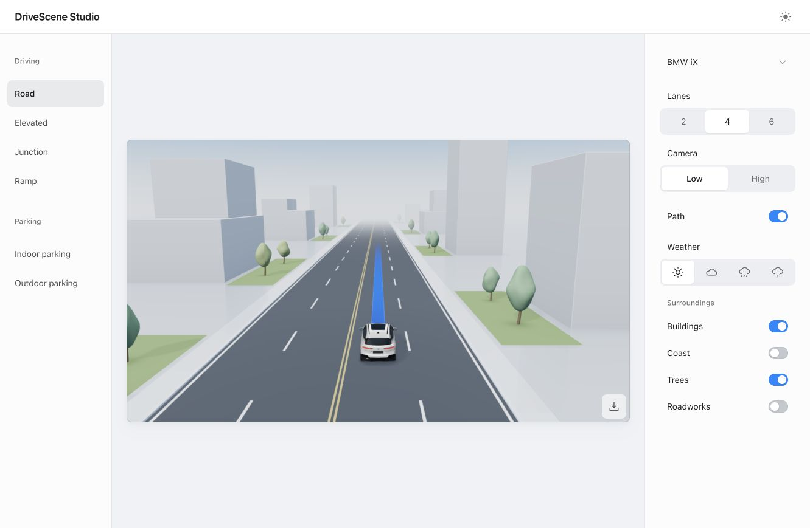

# DriveScene Studio · Three-column preview

This preview adds a three-column scene workspace with compact settings, four vehicle models, theme-aware scenery, weather and export controls. The selected path-activation treatment is **Soft flow**: a single continuous front with a broad feather, sparse particles and a short settling highlight. Its current duration is 544 ms.

## Run

The committed bundle runs without a build step. From this directory, run `python3 -m http.server 8000 --bind 127.0.0.1`, then open `http://127.0.0.1:8000/?layout=triple`.

For source changes, run `npm install`, `npm test` and `npm run build`. The engine build resolves files relative to its own script and can also be invoked from another working directory.

## Interaction

The scene navigation and segmented controls retain their current position and velocity when retargeted. Vehicle selection uses a fixed-duration clipped surface with independent content movement, avoiding a long spring tail at dismissal. Reduced-motion preferences are respected. The path sound plays on an explicit activation, with no sound on startup or restored state.

Light-mode clear roads use a deeper neutral blue-gray; rain adds a further restrained wet-surface darkening. Dark-mode road colors remain unchanged. Geometry, vehicle proportions and path colors retain the selected treatment.

This directory is an independent preview. The repository's existing root entry point and production branch remain unchanged. Model and environment attribution is in [engine/CREDITS.md](engine/CREDITS.md) and [engine/ASSET-LICENSE.md](engine/ASSET-LICENSE.md).
